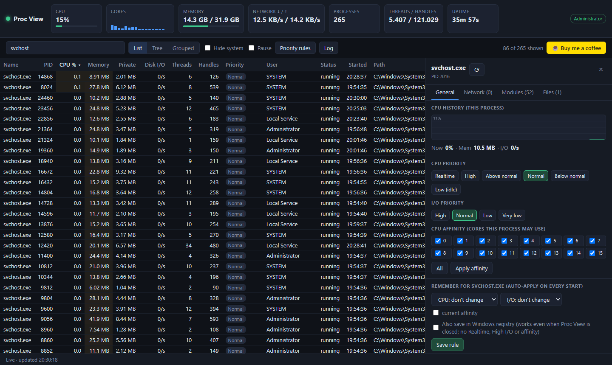
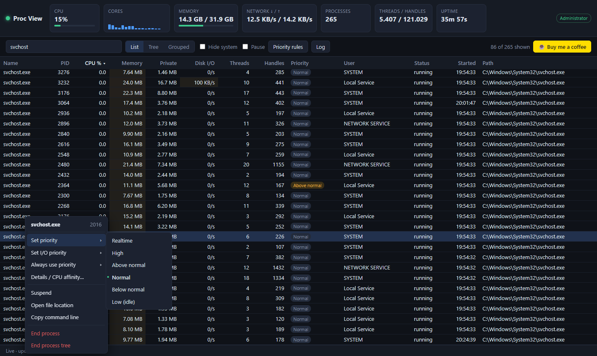
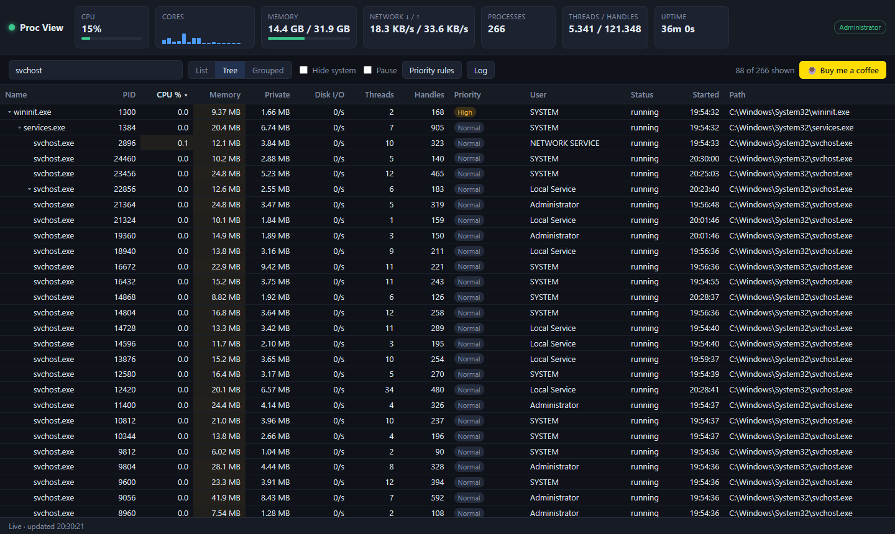
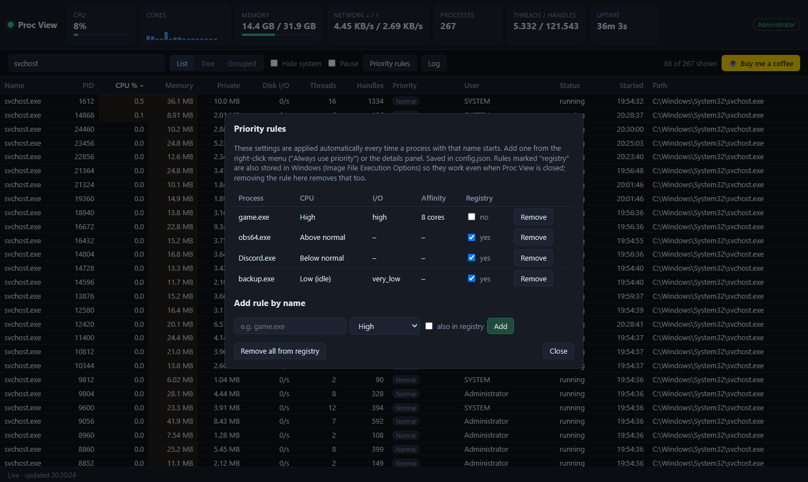
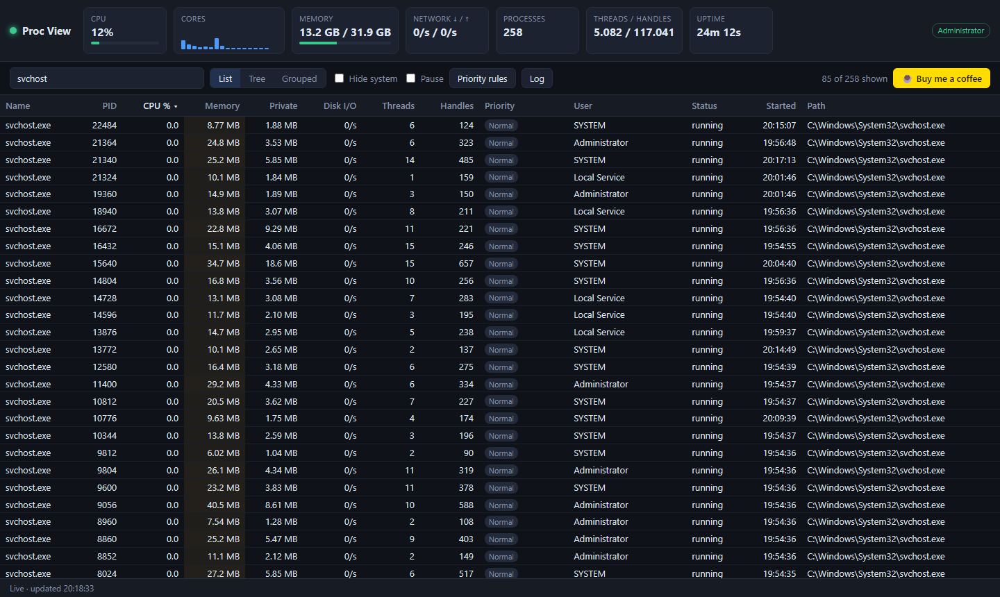

<p align="center"></p>

<h1 align="center">Proc View</h1>

<p align="center"><a href="https://buymeacoffee.com/kuzucevirme"></a></p>

<p align="center">An advanced process viewer for Windows: see every process live and give the ones you care about priority, permanently if you want.</p>



## Features

**See everything**
- Every running process with CPU %, working set, private memory, disk I/O speed, threads, handles,
  priority, user, status, start time and path.
- Sort by any column. Filter by name, PID, user, path or command line (Ctrl+F).
- Three views: **List**, **Tree** (who started what) and **Grouped** (all `chrome.exe` together, summed).
- Header with total CPU, per-core load, memory, network up/down, process/thread/handle counts and uptime.
- Details panel (double-click): live CPU graph, memory breakdown, disk I/O totals, parent/children,
  command line, working directory, network connections, loaded modules, open files.

**Control it**
- **CPU priority**: Realtime, High, Above normal, Normal, Below normal, Low.
- **I/O (disk) priority**: High, Normal, Low, Very low.
- **CPU affinity**: choose which cores a process may use.
- Suspend / resume, end process, end process tree, open file location, copy command line.

**Priority rules (remember it)**
- *Always use priority* saves a rule per program name (e.g. `game.exe` → High). Proc View applies it
  automatically every time that program starts.
- Optional **Also in registry**: the rule is also written to Windows
  (`Image File Execution Options\<name.exe>\PerfOptions`), so Windows itself applies it at program
  start, **even when Proc View is not running**, also after a reboot.

| How you set the priority | After a reboot, Proc View not running |
|---|---|
| Right-click → Set priority | Gone (only for the running instance) |
| Always use priority | Normal again (Proc View must run to apply it) |
| Always use priority + Also in registry | Applied by Windows |

The registry can't store Realtime, High I/O or affinity; those stay Proc View-only.

## Screenshots

| Right-click: set priority | Tree view (who started what) |
|---|---|
|  |  |
| **Priority rules (optionally saved in the registry)** | **Process list** |
|  |  |

## Download & run

1. Download `ProcView.exe` from [Releases](../../releases).
2. Run it. It asks for administrator rights (needed to see and manage system processes).
3. Your browser opens the UI at `http://127.0.0.1:8792`. A tray icon (bottom right) stays running:
   right-click it for **Open** and **Quit**.

Proc View only listens on `127.0.0.1` (your own PC) and has no network or telemetry features.

> Windows SmartScreen or some antivirus programs may warn about unsigned single-file Python apps.
> If you prefer, run it from source (below) or build the `.exe` yourself.

### Run from source

Requires Python 3.10+ on Windows.

```powershell
git clone <this repo>
cd proc-view
pip install -r requirements.txt
pythonw procview.py
```

Or double-click `Start Proc View.bat`, which installs the requirements on first run.

### Build the .exe

```powershell
.\build.bat
```

Output: `dist\ProcView.exe` (PyInstaller, single file, no Python needed on the target PC).

## Usage tips

- **Right-click** a process for priority, I/O priority, *Always use priority*, suspend, end, etc.
- **Double-click** a process for details, affinity and rule settings.
- **Priority rules** button (toolbar) lists all rules; add one by name or remove rules there.
- **Delete** ends the selected process, **Esc** closes menus and dialogs.
- Realtime priority asks for confirmation: a busy process at Realtime can freeze your PC.

## Configuration

All your settings and rules live in **`config.json`** next to `procview.py` / `ProcView.exe`.
It is created with defaults on first start. Delete it to reset Proc View. It is in `.gitignore`.
See [`config.example.json`](config.example.json).

| Key | Default | Meaning |
|---|---|---|
| `host` | `127.0.0.1` | Address the web UI listens on |
| `port` | `8792` | Port of the web UI |
| `open_browser_on_start` | `true` | Open the UI in your browser when Proc View starts |
| `sample_interval_seconds` | `1.5` | How often the process list refreshes |
| `apply_rules_interval_seconds` | `3` | How often new processes are checked against your rules |
| `auto_elevate` | `true` | Ask for administrator rights on start |
| `priority_rules` | `{}` | `{ "name.exe": { "priority": "idle\|below_normal\|normal\|above_normal\|high\|realtime", "io": "very_low\|low\|normal\|high", "affinity": [0, 1], "registry": true } }` |

Command-line flags: `--no-elevate` (don't ask for admin), `--no-browser` (don't open the browser),
`--remove-registry-rules` (see below).

## Uninstall

Rules with **Also in registry** stay in Windows after Proc View is deleted. Remove them first:

- In the app: **Priority rules → Remove all from registry**, or
- Run `ProcView.exe --remove-registry-rules` (or `python procview.py --remove-registry-rules`).

Then delete the folder / exe.

## Support

If Proc View is useful to you, you can [buy me a coffee](https://buymeacoffee.com/kuzucevirme) ☕

## License

[MIT](LICENSE)
